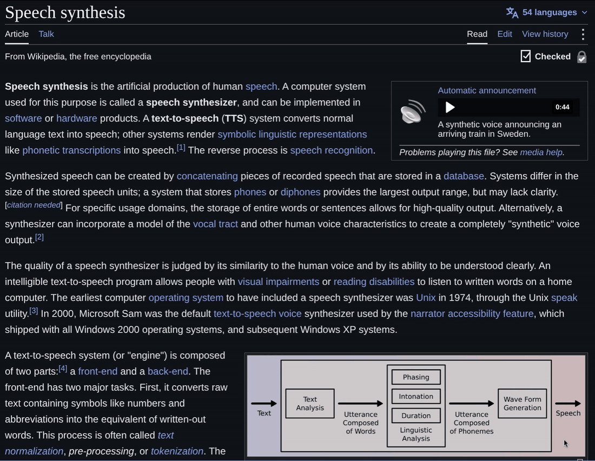

# Kokoro Read-Aloud

**Select text in any app, press Ctrl+Alt+R, and a neural voice running on your
own machine reads it aloud.**

A small local server keeps the [Kokoro-82M](https://huggingface.co/hexgrad/Kokoro-82M)
voice model loaded, and starts speaking while the rest of the text is still
being synthesized. It runs on Linux (Omarchy, Fedora GNOME) and Windows 11,
and your text never leaves the machine.

[Install](#install) • [Usage](#usage) • [Settings](#settings) •
[Troubleshooting](docs/troubleshooting.md) •
[Report a bug](https://github.com/sayed-qutob-work/kokoro-read-aloud/issues/new?template=bug_report.yml)

[](LICENSE)
[](https://github.com/sayed-qutob-work/kokoro-read-aloud/releases)
[](#install)



## Why this one

- **Fast listening that stays clear.** Listen at up to 3× with the voice's
  pitch kept, and see the fastest speed your machine keeps up with.
- **It shows where you are.** A caption strip shows the sentence being read,
  whatever app the text came from.
- **The VRAM back when you need it.** On Omarchy, the bar switches the model
  between GPU, CPU and off, so a game or a local LLM can have the GPU.
- **Pinned and offline.** Packages and model files are pinned to tested
  versions and hashes, and on Linux the server makes no network connection
  after setup.
- **Windows 11 support (retested 2026-10-19 in a VM, without a GPU).** The same
  server, hotkeys and settings as on Linux.

The details behind each of these are in
[how it works](docs/how-it-works.md).

## Before you install

- **English only.** There are 28 American and British voices. Other languages
  in the Latin alphabet get English pronunciation, and other scripts and emoji
  are skipped.
- **A large download.** The GPU build downloads about 4 GB and takes about
  7 GB on disk. The CPU build downloads about 0.7 GB and takes about 2 GB.
- **The GPU build needs NVIDIA.** Elsewhere the CPU build runs, and a slow CPU
  limits how fast you can listen
  ([measurements](docs/how-it-works.md#cpu-or-gpu)).
- **No in-place highlighting on Linux,** only the caption strip.

| Platform | Tested |
|---|---|
| Omarchy 4.0.4 (Hyprland), NVIDIA | Clean install from this repository, 2026-10-18 |
| Fedora 44 (GNOME), NVIDIA | Last run 2026-09-30; the installer not yet run there |
| Windows 11 | Fresh install in a VM without a GPU, 2026-10-19; the GPU path last tested mid-August 2026 |

## Install

On Linux, one command, `kokoroctl setup`, installs everything without root,
outside the code folder. It needs a few system packages first.

<details open>
<summary><b>Omarchy</b> (Hyprland)</summary>

```bash
sudo pacman -S --needed tk portaudio wl-clipboard jq curl libnotify
omarchy plugin add https://github.com/sayed-qutob-work/kokoro-read-aloud --enable
```

1. Omarchy asks you to confirm, because plugins run unsandboxed in the shell.
   Then it asks which bar section to use.
2. A Kokoro icon appears there, as five dim dots. Click it, and pick a build:
   **GPU** (about 4 GB, the default on NVIDIA) or **CPU** (about 0.7 GB).
3. A notification says when Kokoro is ready. Ctrl+Alt+R, T and S are bound
   for you.

To set up from a terminal instead:

```bash
~/.config/omarchy/plugins/io.github.sayed-qutob-work.kokoro-read-aloud/linux/kokoroctl setup
```

</details>

<details>
<summary><b>Fedora</b> (GNOME)</summary>

```bash
sudo dnf install python3-tkinter python3-xlib portaudio wl-clipboard jq curl libnotify
git clone https://github.com/sayed-qutob-work/kokoro-read-aloud.git
cd kokoro-read-aloud
linux/kokoroctl setup
```

Setup doesn't bind GNOME shortcuts; it prints the three commands. Bind
them in Settings > Keyboard > View and Customize Shortcuts > Custom Shortcuts.
`kokoroctl setup` has not been run on Fedora yet; please
[report](https://github.com/sayed-qutob-work/kokoro-read-aloud/issues/new?template=bug_report.yml)
what happens.

</details>

<details>
<summary><b>Windows 11</b> (retested 2026-10-19 in a VM, without a GPU)</summary>

You need [Python 3.12](https://www.python.org/downloads/) (exactly 3.12),
[AutoHotkey v2](https://www.autohotkey.com/) and the
[Visual C++ runtime](https://aka.ms/vs/17/release/vc_redist.x64.exe), which
torch needs and a fresh Windows lacks
(`winget install Microsoft.VCRedist.2015+.x64`).

In PowerShell or Command Prompt:

```powershell
git clone https://github.com/sayed-qutob-work/kokoro-read-aloud.git
cd kokoro-read-aloud
py -3.12 -m venv env
env\Scripts\python.exe -m pip install -r requirements-cuda.txt
env\Scripts\python.exe tts_server.py
```

Without an NVIDIA GPU, install `requirements.txt` instead of
`requirements-cuda.txt`.

When it prints `[kokoro] ready on http://127.0.0.1:5111`, start
`read_aloud.ahk`. To start everything at login, put a shortcut to
`start_tts.vbs` in `shell:startup`.

</details>

What setup does, where the files go, and the Windows details are in
[install.md](docs/install.md).

## Usage

| Keys | Action |
|---|---|
| `Ctrl+Alt+R` | Read the selection |
| `Ctrl+Alt+T` | Read the clipboard as-is |
| `Ctrl+Alt+S` | Stop |

The hotkeys work wherever text can be selected, including terminals and
PDFs. On Linux the selection is read without copying it. On Windows the
hotkey copies it and then puts your clipboard back; in a terminal there, turn
on [copy-on-select](docs/install.md#optional-extras).

- **The Omarchy bar icon:**
  - left click opens the panel: GPU / CPU / Off, voice, speed, captions;
  - right click turns the model off or on;
  - middle click stops.

  See [omarchy.md](docs/omarchy.md).
- **The caption strip** is off by default. Turn it on with Captions in the
  Omarchy panel, or with `systemctl --user enable --now kokoro-overlay` on
  any Linux ([options](docs/settings.md#caption-strip)).
- **On Windows,** the spoken word is also tinted in the app itself: in
  Firefox, in Notepad, and in Chrome or Edge with the bundled extension
  ([details](docs/windows.md)).
- **From a terminal** on Linux, `kokoroctl` turns the model off and on,
  switches GPU and CPU, and changes the voice and speed
  ([reference](docs/omarchy.md#kokoroctl)).

## Privacy and security

- **Your text stays on your machine.** The model runs locally, and the
  server listens only on 127.0.0.1.
- **No network after setup, on Linux.** The server loads the pinned model
  files from disk in Hugging Face's offline mode. It was tested with no
  network at all. On Windows, see [install.md](docs/install.md#windows).
- **Web pages can't use it.** The server refuses requests from browser tabs,
  including DNS rebinding, and accepts only JSON from local programs. Until
  2026-10-18 a web page could make it speak and read what it was reading:
  [the three attacks, measured before and after the fix](docs/security.md).
  Any program running as you can still use it, as with any local service.
- **The clipboard is never polled.** On Linux the hotkey doesn't touch it at
  all.
- **Pinned downloads.** Every package and every model file is checked
  against a pinned hash, and so is uv when setup downloads it.
- **No root,** except for the system packages you install yourself.
- **The Omarchy plugin runs unsandboxed** in the shell, like every Omarchy
  plugin.
- **The logs stay local.** `read_aloud.log` keeps a short excerpt of each
  selection, for diagnosing wrong reads.

## Settings

The Settings panel changes the voice, speed, pauses, output device and
caption strip. It also shows the fastest speed your machine keeps up with.
To open it:
- **Windows:** the tray icon.
- **Omarchy:** More settings, in the bar panel. The voice and speed are also
  right in the panel.
- **GNOME:** "Kokoro Settings" in the app grid.

Settings are saved in `settings.json` and survive a restart. The keys, all 28
voices with their grades, and the caption options are in
[settings.md](docs/settings.md).

## Updating and uninstalling

| | Update | Uninstall |
|---|---|---|
| Omarchy | `omarchy plugin update io.github.sayed-qutob-work.kokoro-read-aloud`, then `omarchy restart shell` and `kokoroctl setup` | `kokoroctl uninstall`, then `omarchy plugin remove io.github.sayed-qutob-work.kokoro-read-aloud` |
| Fedora | `git pull`, then `kokoroctl setup` | `kokoroctl uninstall`, remove the GNOME shortcuts, delete the folder |
| Windows | `git pull`, the same `pip install -r` again, restart the server | [Three steps](docs/install.md#removing) |

`kokoroctl uninstall` asks before it does anything. It keeps your settings
unless you pass `--purge`. More in [install.md](docs/install.md#removing).

## Troubleshooting

- **Something failed:** read `server.log` first. On Linux, `kokoroctl log`
  opens it.
- **Reads stall or stutter:** lower the reading speed until the panel's
  warning clears, or use the GPU.
- **"Kokoro is off" or "still loading":** turn it on from the bar, or with
  `kokoroctl gpu`. Loading takes about 6 s.
- **"No matching distribution found for kokoro" on Windows:** the venv isn't
  Python 3.12.

More cases, and what each log holds, are in
[troubleshooting.md](docs/troubleshooting.md).

## How it works

A Flask server on 127.0.0.1:5111 keeps Kokoro-82M loaded. The hotkey script
sends it the text. The server splits it at commas and full stops, synthesizes
ahead of playback, time-stretches without changing pitch, and plays it. The
caption strip, the Windows highlighter and the bar widget only read the
server's state.

The details are in [how-it-works.md](docs/how-it-works.md). The measurements
behind this README, each with the machine it was taken on, are in
[AUDIT.md](docs/AUDIT.md), the project's engineering log.

## Related projects

From each project's own README, October 2026.

**Omarchy, with Kokoro:**
- [Omatalk](https://github.com/zerobearing2/omatalk): reads the selection on F8, with Kokoro on the CPU.
- [Say It](https://github.com/txapotxapa/sayit-omarchy): a bar player that highlights each word; 54 voices in nine languages.
- [Read Aloud: Text to Speech](https://github.com/remigius-labs/omarchy-read-aloud): reads the clipboard from the bar; 54 voices in nine languages.
- [kokoro-tts-omarchy](https://github.com/MASH2RAFI/kokoro-tts-omarchy): GPU builds for NVIDIA, AMD and Intel.
- [omarchy-tts](https://github.com/jagrat7/omarchy-tts): several local and cloud voice engines behind one key.
- [omarchy-speak](https://github.com/seanpowless-dotcom/omarchy-speak): Piper for speed, Kokoro for quality.
- [Omarchy Talks](https://github.com/Zerolxgic/Omarchy-Talks): reads the selection through VoiceBox.

**Elsewhere:**
- [Speech Note](https://github.com/mkiol/dsnote): an offline Linux app for text-to-speech, speech-to-text and translation.
- [Pied](https://github.com/Elleo/pied): installs Piper voices for Speech Dispatcher, so other Linux apps can use them.
- [kokoro-sapi](https://github.com/RvRooijen/kokoro-sapi): Kokoro as a Windows SAPI voice, for apps that use system voices.
- [TinyReadAloud](https://github.com/dorofino/TinyReadAloud): a Windows tray app that reads the selection on Ctrl+Alt+R.
- [Read Aloud](https://github.com/ken107/read-aloud): a browser extension that reads web pages.
- [Kokoro-FastAPI](https://github.com/remsky/Kokoro-FastAPI): Kokoro behind an OpenAI-compatible speech API, in Docker.

## Credits and licenses

The code here is MIT-licensed. It builds on, and redistributes none of:
- [Kokoro-82M](https://huggingface.co/hexgrad/Kokoro-82M) and
  [kokoro](https://github.com/hexgrad/kokoro) by hexgrad (Apache-2.0);
- PyTorch;
- eSpeak NG (GPL-3.0);
- and more.

The full list, and what redistributing a bundle would require, is in
[licenses.md](docs/licenses.md). This project is not affiliated with hexgrad
or the Kokoro project.

## Contributing and support

Bug reports and ideas welcome via
[issues](https://github.com/sayed-qutob-work/kokoro-read-aloud/issues/new/choose).
For pull requests, please open an issue first.

- **Bugs:** the
  [bug report form](https://github.com/sayed-qutob-work/kokoro-read-aloud/issues/new?template=bug_report.yml)
  asks for your platform, `kokoroctl status` and the logs.
- **Security problems:** please report them privately, as described in
  [SECURITY.md](SECURITY.md).
- **Before changing code,** read [docs/README.md](docs/README.md). The
  engineering docs record what was measured, and what was tried and
  rejected.

## License

MIT, see [LICENSE](LICENSE).
