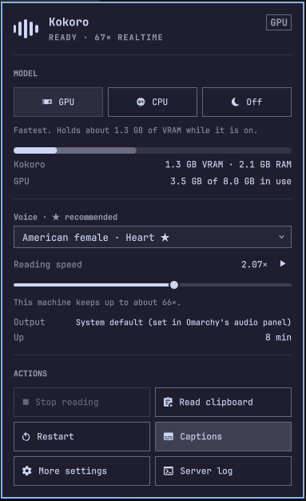
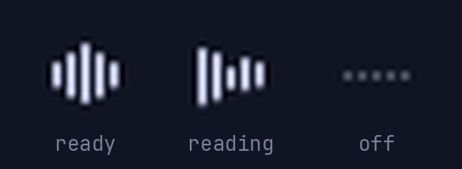

# The Omarchy bar widget, and `kokoroctl`

On Omarchy, the plugin puts a Kokoro icon in the bar. It is built from the
shell's own components, so it follows your theme and keyboard conventions like
the built-in panels do.

It exists mainly to give the GPU back. The server keeps the model loaded all
day, and a game or a local LLM may need that VRAM.

[`kokoroctl`](#kokoroctl), the command the widget runs, works on any Linux
install.



## The icon



The bars move while it reads, ripple while the model loads, and turn into dim
dots when it is off. Before setup has run, the icon is also five dim dots,
and the panel offers setup instead of the controls below.

| Input | Does |
|---|---|
| Left click | Open the panel |
| Right click | Turn the model off, freeing its VRAM, or back on |
| Middle click | Stop the current read |
| In the panel | Arrows or `hjkl` move, `Enter` activates, `Esc` closes. `g` / `c` / `o` pick GPU / CPU / Off, `s` stops reading, `r` restarts |

## The panel

- **GPU / CPU / Off.** CPU mode restarts the server with the GPU hidden from
  it. It uses no VRAM, and reads keep working.
- **Kokoro's share of the GPU's memory,** next to every other process, plus
  the RAM it holds.
- **The sentence being read,** with the part already spoken shown brighter.
- **Voice.** All 28 English voices, grouped by accent and gender, applied
  and saved as soon as you pick one. A ★ marks the four that Kokoro's authors
  grade B- or better. No male voice is graded that high, so the three best
  male voices (all C+) are marked "best male". The full list and grades are in
  [settings.md](settings.md#voices).
- **Reading speed.** The slider applies while you drag it and saves when you
  let go. ▶ reads a sample sentence. The line under the slider gives the
  fastest speed this machine keeps up with, and warns when you go past it.
- **Output.** The system default, which you pick in Omarchy's audio panel.
  Kokoro follows a change there, even in the middle of a read. To send it to
  one specific device instead, use More settings.
- **Actions:**
  - stop reading;
  - read the clipboard;
  - restart;
  - captions on/off;
  - More settings, which opens the full [Settings panel](settings.md);
  - follow `server.log`.

## What each mode costs

Measured on an RTX 4060 Ti with an i5-12400F:

| Mode | VRAM | RAM | First sound | Synthesis speed |
|---|---|---|---|---|
| GPU | 0.8 GB after a start, up to 1.6 GB with use | ~2 GB | 0.06–0.1 s | 20–87x realtime |
| CPU | none | 1.5–1.8 GB | 0.35–0.5 s | 4.4–5.3x realtime |
| Off | none | none | n/a | n/a |

- **Switching** to GPU or CPU takes about 6 s, the time it takes to load the
  model. Switching off is immediate.
- **On the CPU,** a very short first sentence can be followed by a brief
  pause. The next chunk takes longer to synthesize than the first one takes to
  play.
- **CPU mode lasts until you log out.** The next login starts on the GPU
  again.
- **A hotkey pressed while Kokoro is off** shows a notification and does not
  start the model, so a game keeps its VRAM.
- **On the CPU build** (chosen at setup), GPU mode is greyed out: that build
  of PyTorch cannot use the GPU. `kokoroctl setup --cuda` switches builds.

## kokoroctl

The widget runs everything through `kokoroctl`, which also works on its own,
on any Linux install. Setup puts it in `~/.local/bin`.

```bash
kokoroctl off       # stop the server: VRAM and RAM freed, hotkeys go quiet
kokoroctl cpu       # run on the CPU: no VRAM, reads keep working
kokoroctl gpu       # back on the GPU
kokoroctl restart   # same device as now
kokoroctl status    # JSON: state, device, VRAM/RAM, live config
kokoroctl set voice=bf_emma speed=2.1   # change them live and save them
kokoroctl sample    # read a sample sentence with the current settings
```

It also takes:
- `stop`, `clipboard` and `captions [on|off|toggle]`;
- `settings`, which opens the Settings panel (`--json` prints the voice,
  speed and voice list instead);
- `log [setup]`;
- `setup [--cpu|--cuda] [--background]` and `uninstall [--yes] [--purge]`,
  see [install.md](install.md).
